# 🎓 CampusTrace — University Lost & Found Hub

> **Milestone-1 Graded Project (25 Marks)**  
> **Course:** Tech Week Sprint / Web Application Architecture  
> **Tech Stack:** Next.js 14, React 18, Tailwind CSS, React Context API, Lucide Icons

---

## 🌟 Startup Inspiration
* **Inspiration Source:** **Product Hunt & Y Combinator (YC S22)**
* **Reference Product:** [Boomerang](https://www.ycombinator.com/companies/boomerang) (YC S22, Product Hunt #1 Product of the Day).
* **Adaptation Rationale:** Boomerang modernized lost-and-found operations for venues and commercial spaces. **CampusTrace** adapts this foundational thesis into an enterprise-grade digital lost-and-found platform tailored specifically to college campuses, incorporating student roll numbers, campus buildings, safe custody desks, and anti-fraud verification challenges.

---

## 📋 Table of Contents
1. [Problem Statement](#-problem-statement)
2. [Product Overview](#-product-overview)
3. [Key Deliverables](#-key-deliverables)
4. [System Architecture](#-system-architecture)
5. [Project Structure](#-project-structure)
6. [Team Division & GitHub Issues](#-team-division--github-issues)
7. [Getting Started (Run Locally)](#-getting-started-run-locally)
8. [Final Presentation Guide (10 Mandatory Points)](#-final-presentation-guide)

---

## ❓ Problem Statement
College campuses suffer from extreme fragmentation of lost items:
* Items left in lecture halls, libraries, or dining halls end up haphazardly scattered across multiple departmental offices and security gates.
* Students waste hours physically wandering between buildings or spamming noisy group chats.
* Traditional physical "Lost Boxes" have zero searchability and over 70% of lost belongings remain permanently unclaimed.
* Informally claimed items have no proof verification, creating risks of theft or wrongful handover.

**CampusTrace** solves this with a centralized digital catalog, campus zone filtering, and structured ownership claim verification.

---

## 🚀 Product Overview
* **Interactive Directory & Search:** Real-time multi-filter feed (`All`, `Lost`, `Found`, `Reunited`), campus zone filter (Library, Academic Blocks, Cafeteria, Hostels), and keyword search.
* **60-Second Posting Flow:** Rapid submission forms for both lost and found belongings with photo selection and security challenge questions.
* **Ownership Challenge Modal:** Claimants submit specific proof (markings, stickers, serials) that only the true owner would know.
* **Campus Security & Helpdesk Portal (`/admin`):** Dedicated custody desk table to inspect claims, approve handovers, and update item lifecycle.
* **Demo Role Switcher:** Toggle between Student view (Roll #24CS109) and Campus Security Officer (Gate 1) with one click.

---

## 📑 Key Deliverables
- [`PRODUCT-ASSUMPTIONS.md`](./PRODUCT-ASSUMPTIONS.md) — 8-question product assumption and MVP scope document.
- [`WIREFRAME.md`](./WIREFRAME.md) — ASCII wireframes, information architecture, and end-to-end user flows.
- [`DESIGN-SYSTEM.md`](./DESIGN-SYSTEM.md) — Comprehensive visual system (Colors, Typography scale, Reusable UI Components).
- [`PROJECT-PLAN.md`](./PROJECT-PLAN.md) — Issue tracking roadmap (#1 to #14) and student division of work.

---

## 🏗 System Architecture

```mermaid
flowchart TD
    NextApp["Next.js 14 App Router"]
    
    subgraph PagesLayer["Pages (/app)"]
        Landing["Landing (/)"]
        Dashboard["Dashboard (/dashboard)"]
        ReportLost["Report Lost (/report-lost)"]
        ReportFound["Report Found (/report-found)"]
        ItemDetail["Item Detail (/item/:id)"]
        MyItems["My Activity (/my-items)"]
        Admin["Security Desk (/admin)"]
        Login["Login & Register (/login)"]
    end

    subgraph ComponentsLayer["Reusable Components (/components)"]
        Navbar["Navbar & MobileNav"]
        Button["Button (Variants & Sizes)"]
        Badge["Status Badges (Lost/Found/Reunited)"]
        Card["Card & ItemCard"]
        Modal["Modal & ClaimModal"]
        InputComp["Input, Textarea, Select"]
        TableComp["Table & EmptyState"]
    end

    subgraph StateLayer["React Context (/context)"]
        ItemCtx["ItemContext (Items, Filters, Claims, Stats)"]
        AuthCtx["AuthContext (User Session, Student/Admin Role)"]
    end

    subgraph DataLayer["Mock / Dummy Data (/context/dummyData.js)"]
        PreloadedData["INITIAL_ITEMS (10+ Realistic Records)"]
        Locations["CAMPUS_LOCATIONS"]
        Categories["CATEGORIES"]
        LocalStorage["Client-Side LocalStorage Persistence"]
    end

    NextApp --> PagesLayer
    PagesLayer --> ComponentsLayer
    ComponentsLayer --> StateLayer
    StateLayer --> DataLayer
```



---

## 📂 Project Structure

```
lost-and-found/
├── app/
│   ├── admin/
│   │   └── page.jsx             # Campus Security Custody & Claim Review Portal
│   ├── dashboard/
│   │   └── page.jsx             # Search, Filter & Browse Feed
│   ├── item/
│   │   └── [id]/
│   │       └── page.jsx         # Dynamic Item Details & Claim Resolution
│   ├── login/
│   │   └── page.jsx             # Campus Portal Sign-In (with instant demo pills)
│   ├── my-items/
│   │   └── page.jsx             # Student Activity (My Reports & Submitted Claims)
│   ├── register/
│   │   └── page.jsx             # Student Registration Form
│   ├── report-found/
│   │   └── page.jsx             # Found Item Logging Form
│   ├── report-lost/
│   │   └── page.jsx             # Lost Item Broadcast Form
│   ├── globals.css              # Tailwind Base & Global Typography
│   ├── layout.jsx               # Root Layout with Context Providers & Navbar
│   └── page.jsx                 # Landing Page Hero & Metrics
├── components/
│   ├── Badge.jsx                # Multi-color status pills (Lost, Found, Reunited)
│   ├── Button.jsx               # Reusable button with variants & sizes
│   ├── Card.jsx                 # Base elevated card container
│   ├── ClaimModal.jsx           # Ownership proof submission dialog
│   ├── EmptyState.jsx           # Illustrated empty query fallback
│   ├── Input.jsx                # FormField, Input, Textarea, Select components
│   ├── ItemCard.jsx             # Catalog item card with image & badges
│   ├── LoadingState.jsx         # Skeleton loading states
│   ├── Modal.jsx                # Accessible overlay modal dialog
│   ├── Navbar.jsx               # Sticky top navigation with role switcher
│   └── Table.jsx                # Responsive data table for admin desk
├── context/
│   ├── AuthContext.jsx          # User session & role switcher (Student / Admin)
│   ├── dummyData.js             # 10+ authentic campus dummy items
│   └── ItemContext.jsx          # Central reactive state engine & LocalStorage sync
├── public/                      # Static assets & logos
├── DESIGN-SYSTEM.md             # UI design token documentation
├── PRODUCT-ASSUMPTIONS.md       # Product assumptions & MVP specifications
├── PROJECT-PLAN.md              # Sprint plan & GitHub issues breakdown
├── WIREFRAME.md                 # ASCII wireframes & interaction blueprints
├── package.json
└── README.md
```

---

## 👥 Team Division & GitHub Issues

| Contributor | Focus Area | Key Responsibilities |
| :--- | :--- | :--- |
| **Student 1** | Architecture & State Engine | Next.js Setup, React Context (`ItemContext`, `AuthContext`), Security Desk (`/admin`), Dashboard Filtering, Item Details. |
| **Student 2** | UI Engineering & Components | Design System, Reusable Components (`Button`, `Card`, `Badge`, `Modal`, `Input`), Landing Page, Report Forms, Dummy Dataset. |

### Core GitHub Issues
* **#1 Project Setup:** Next.js 14, Tailwind CSS, PostCSS configuration *(Assigned: Student 1)*
* **#2 Product Assumptions:** `PRODUCT-ASSUMPTIONS.md` documentation *(Assigned: Student 2)*
* **#3 Wireframing:** `WIREFRAME.md` structural diagrams *(Assigned: Student 2)*
* **#4 Design System:** `DESIGN-SYSTEM.md` token specifications *(Assigned: Student 2)*
* **#5 React Context Engine:** `ItemContext.jsx` with CRUD & claim workflows *(Assigned: Student 1)*
* **#6 Reusable Components:** Button, Badge, Card, Modal, Input *(Assigned: Student 2)*
* **#7 Global Navigation:** Sticky Navbar with role switcher *(Assigned: Student 1)*
* **#8 Landing Page:** Hero section, search jump, recovery stats *(Assigned: Student 2)*
* **#9 Dashboard Directory:** Multi-filter feed & status tabs *(Assigned: Student 1)*
* **#10 Report Forms:** `/report-lost` & `/report-found` pages *(Assigned: Student 2)*
* **#11 Claim Verification:** Proof challenge modal & security custody *(Assigned: Student 1)*
* **#12 Admin Console:** Tabular review for campus security gate *(Assigned: Student 1)*
* **#13 Dummy Dataset:** 10+ realistic college scenarios *(Assigned: Student 2)*
* **#14 Documentation & Presentation:** Video script & README *(Both Students)*

---

## 💻 Getting Started (Run Locally)

### Prerequisites
* Node.js `v18.x` or higher
* npm `9.x` or higher

### Steps to Run
1. **Clone the repository:**
   ```bash
   git clone https://github.com/your-username/lost-and-found.git
   cd lost-and-found
   ```

2. **Install dependencies:**
   ```bash
   npm install
   ```

3. **Start the development server:**
   ```bash
   npm run dev
   ```

4. **Open in your browser:**
   ```
   http://localhost:3000
   ```

---

## 🎤 Final Presentation Guide
During the video presentation, cover the 10 graded points in order:

1. **Problem:** Misplaced college belongings are scattered across disparate departments with zero searchability; over 70% remain unrecovered.
2. **Product:** **CampusTrace**, a digital Lost and Found portal with building filters and ownership verification.
3. **Inspiration:** Inspired by **Boomerang** (YC S22 / Product Hunt #1), adapted for college roll numbers and campus custody desks.
4. **Target Users:** College students, faculty members, campus security officers at gate desks, and cleaning staff.
5. **Assumptions:** Students carry smartphones, understand campus landmarks, and require privacy safeguards (no public phone broadcasting).
6. **Wireframe:** Walk through the structural layouts in `WIREFRAME.md` (Landing, Search Feed, Reporting Forms, Claim Dialog).
7. **Design System:** Present `DESIGN-SYSTEM.md` (Blue `#2563EB`, Indigo `#4F46E5`, Inter typography scale, reusable Button, Badge, Modal, and Card tokens).
8. **Architecture:** Explain `Next.js -> Pages -> Components -> React Context -> Dummy Data` state flow.
9. **GitHub:** Showcase project repository, issue breakdown (#1–#14), meaningful commit logs (`feat:`, `docs:`, `fix:`), and contributions from both teammates.
10. **Live Demo:**
    * Demonstrate searching for "Calculator" in the feed.
    * Post a new lost item alert in Block B.
    * Switch role from Student to Campus Security Officer.
    * Review an ownership claim in the Security Desk (`/admin`) and click "Approve & Mark Handed Over".
    * Show live update of the recovery rate metric.
