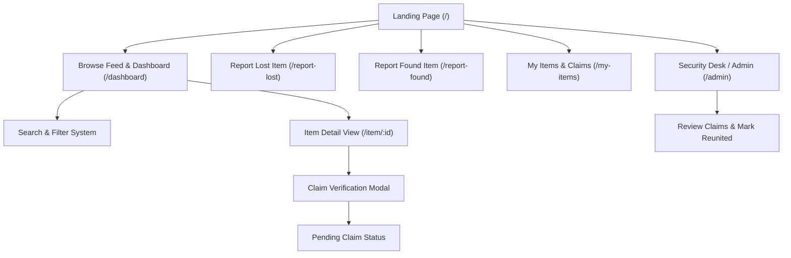

# CampusTrace Wireframes & User Flows

This document details the page structures, navigation hierarchy, wireframe layouts, forms, buttons, cards, and key interactions for the **CampusTrace** College Lost & Found platform.

---

## 1. Information Architecture & Navigation Map



---

## 2. Wireframe 1: Landing Page (`/`)

```
+----------------------------------------------------------------------------------+
|  [Logo] CampusTrace     [Dashboard]  [Report Lost]  [Report Found]   [Admin Desk] [User Profile] |
+----------------------------------------------------------------------------------+
|                                                                                  |
|                      LOST SOMETHING ON CAMPUS? WE'VE GOT YOU.                    |
|          The official central lost & found network for college students & staff  |
|                                                                                  |
|      +--------------------------------------------------------------------+      |
|      |  [Q] Search by item name, room, or building (e.g. 'Calculator')... | [Search] |
|      +--------------------------------------------------------------------+      |
|                                                                                  |
|            [ + Report Lost Item (I Lost) ]      [ + Report Found Item (I Found) ]|
|                                                                                  |
+----------------------------------------------------------------------------------+
|  CAMPUS RECOVERY METRICS                                                         |
|  +--------------------+  +--------------------+  +--------------------+          |
|  |    142 Items       |  |     118 Reunited   |  |     83% Recovery   |          |
|  |    Reported        |  |     With Owners    |  |     Success Rate   |          |
|  +--------------------+  +--------------------+  +--------------------+          |
+----------------------------------------------------------------------------------+
|  RECENTLY REPORTED ACTIVITY                                                      |
|  +-----------------------------+  +-----------------------------+                |
|  | [LOST] Red Hydro Flask      |  | [FOUND] Casio fx-991EX Calc |                |
|  | Loc: Central Library Floor 2|  | Loc: Block B - Lab 102      |                |
|  | Date: Today, 10:15 AM       |  | Custody: Main Security Desk |                |
|  | [View Details]              |  | [Claim This Item]           |                |
|  +-----------------------------+  +-----------------------------+                |
+----------------------------------------------------------------------------------+
```

---

## 3. Wireframe 2: Item Feed & Search Dashboard (`/dashboard`)

```
+----------------------------------------------------------------------------------+
|  [Logo] CampusTrace     [Dashboard]  [Report Lost]  [Report Found]   [Admin Desk] [User Profile] |
+----------------------------------------------------------------------------------+
|  Dashboard > Browse Campus Listings                                              |
|                                                                                  |
|  [ Search input: "Search items, keywords, location..." ]        [ Sort By: Newest v ] |
|                                                                                  |
|  STATUS TABS:   [ (All: 12) ]   [ (Lost: 5) ]   [ (Found: 7) ]   [ (Reunited: 4) ]|
|                                                                                  |
|  CATEGORY CHIPS: [ All ] [ Electronics ] [ ID Cards ] [ Keys ] [ Books ] [ Bags ]|
|                                                                                  |
|  LOCATION FILTER: [ All Campus Locations v ]   (e.g., Library, Block A, Cafeteria)|
+----------------------------------------------------------------------------------+
|  LISTINGS GRID (Responsive Cards)                                                |
|                                                                                  |
|  +--------------------------------+  +--------------------------------+          |
|  | [Image / Icon]    [BADGE: LOST]|  | [Image / Icon]   [BADGE: FOUND]|          |
|  | Casio Scientific Calculator    |  | Apple AirPods Pro Case         |          |
|  | Category: Electronics          |  | Category: Electronics          |          |
|  | Location: Block B - Lab 104    |  | Location: Campus Cafeteria     |          |
|  | Date: Oct 28, 2026             |  | Custody: Library Helpdesk      |          |
|  | Reported By: Roll #24CS109     |  | Date: Oct 29, 2026             |          |
|  |                                |  |                                |          |
|  | [View Details & Contact]       |  | [Claim This Item]              |          |
|  +--------------------------------+  +--------------------------------+          |
|                                                                                  |
|  +--------------------------------+  +--------------------------------+          |
|  | [Image / Icon]    [BADGE: LOST]|  | [Image / Icon][BADGE: REUNITED]|          |
|  | College ID Card (Ananya S.)    |  | Blue College Spiral Notebook   |          |
|  | Category: Documents & ID       |  | Category: Books & Stationery   |          |
|  | Location: Central Sports Ground|  | Reunited with owner on Oct 27  |          |
|  | [View Details & Contact]       |  | [Resolved Case Closed]         |          |
|  +--------------------------------+  +--------------------------------+          |
+----------------------------------------------------------------------------------+
```

---

## 4. Wireframe 3: Report Lost / Found Item Form

```
+----------------------------------------------------------------------------------+
|  REPORT AN ITEM                                                                  |
|  Toggle Type:   ( * ) I Lost An Item           (   ) I Found An Item             |
+----------------------------------------------------------------------------------+
|  Item Title:                                                                     |
|  [ e.g., Black Dell Laptop Charger 65W                                         ] |
|                                                                                  |
|  Category:                               Campus Zone / Location:                 |
|  [ Select: Electronics              v ]  [ Select: Main Library Floor 1      v ] |
|                                                                                  |
|  Specific Spot / Landmark:                                                       |
|  [ Near study cubicle #14, by the window power sockets                         ] |
|                                                                                  |
|  Date & Time When Lost / Found:                                                  |
|  [ 2026-10-28 ] [ 14:30 ]                                                        |
|                                                                                  |
|  Custody / Whereabouts (for Found items):                                        |
|  [ Handed over to Central Security Desk Gate 1                                 ] |
|                                                                                  |
|  Distinctive Identifiers / Description:                                          |
|  [ Has a small yellow Pikachu sticker on the adapter brick. Cord has a wire clip] |
|                                                                                  |
|  Security Verification Question (To verify claimant):                           |
|  [ What brand of sticker is on the back?                                       ] |
|                                                                                  |
|  Your Contact Email / Roll No:                                                   |
|  [ student.roll@college.edu                                                    ] |
|                                                                                  |
|  [ Cancel ]                                            [ + Submit Report Button] |
+----------------------------------------------------------------------------------+
```

---

## 5. Wireframe 4: Ownership Claim & Verification Modal

```
+----------------------------------------------------------------------------------+
|  CLAIM OWNERSHIP: Apple AirPods Pro (2nd Gen)                        [ X Close ] |
+----------------------------------------------------------------------------------+
|  Item currently held at: Main Campus Security Desk Gate 1                        |
|                                                                                  |
|  To prevent false claims, please answer the owner verification challenge:        |
|                                                                                  |
|  Owner Challenge:                                                                |
|  "Describe the case cover or engraved name on the inside lid."                   |
|                                                                                  |
|  Your Proof / Answer:                                                            |
|  +----------------------------------------------------------------------------+  |
|  | It has a matte navy silicone case with a tiny scratch on the left hinge,    |  |
|  | and the Bluetooth pairing name is 'Rohan_AirPods'.                         |  |
|  +----------------------------------------------------------------------------+  |
|                                                                                  |
|  Your Student Roll Number / College ID:                                          |
|  [ 23CS041                                                                     ] |
|                                                                                  |
|  Your Phone / College Email:                                                     |
|  [ rohan.k@college.edu                                                         ] |
|                                                                                  |
|  [ Cancel ]                                          [ Submit Verification Claim]|
+----------------------------------------------------------------------------------+
```

---

## 6. Wireframe 5: Campus Security / Admin Desk View (`/admin`)

```
+----------------------------------------------------------------------------------+
|  CAMPUS SECURITY & HELPDESK RECOVERY PORTAL                                      |
|  Manage all custody items, verify pending claims, and mark cases resolved        |
+----------------------------------------------------------------------------------+
|  FILTER: [ All Status v ]   [ All Buildings v ]    [ Search Claimant / Item... ] |
|                                                                                  |
|  +---------+-------------------+---------------+------------------+------------+ |
|  | Item ID | Item Name         | Campus Loc    | Current Custody  | Action     | |
|  +---------+-------------------+---------------+------------------+------------+ |
|  | #101    | Casio Calculator  | Block B - 104 | Library Counter  | [Resolved] | |
|  | #102    | AirPods Case      | Cafeteria     | Security Gate 1  | [Review (1)] |
|  | #103    | College ID Card   | Sports Ground | Main Office      | [Resolved] | |
|  +---------+-------------------+---------------+------------------+------------+ |
+----------------------------------------------------------------------------------+
```
